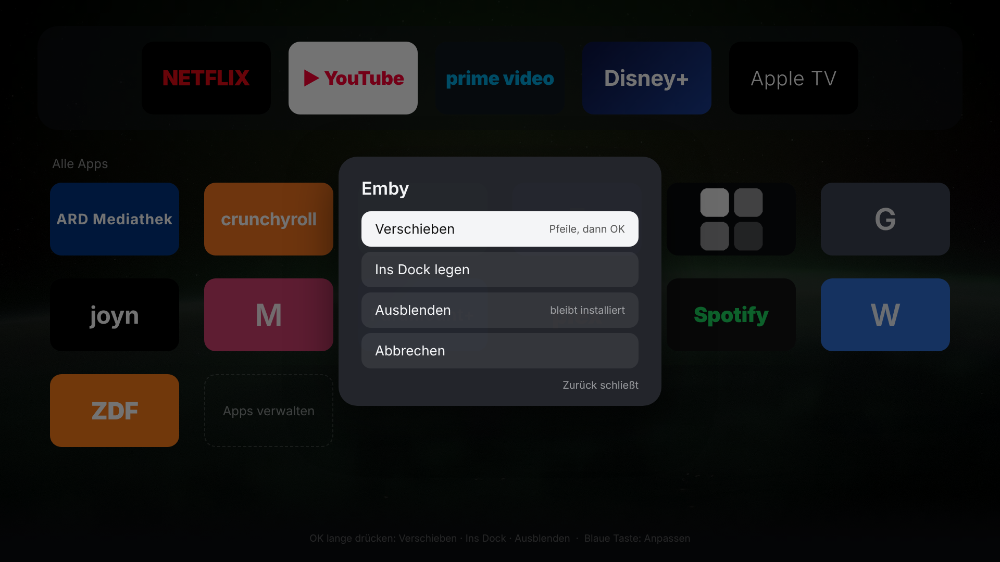
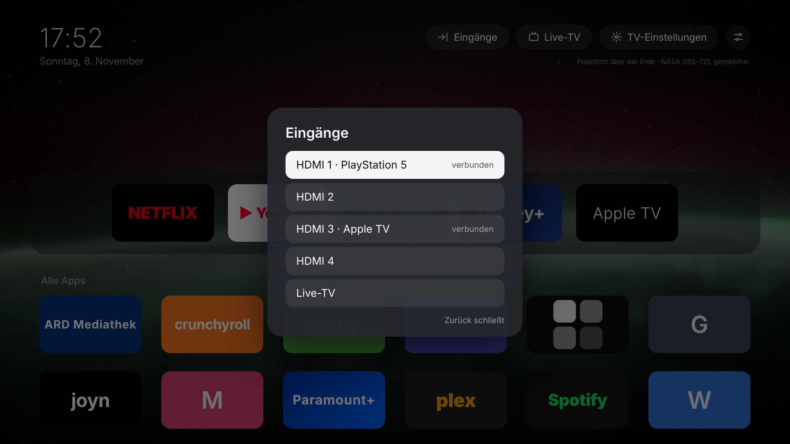

# CleanHome für LG webOS

Ein ruhiger, dunkler Startbildschirm für deinen **LG OLED55B39LA (webOS 25)**, angelehnt an
[cleanyourtv](https://github.com/Gathin23/cleanyourtv): deine Apps im Dock, alle übrigen in einem Raster,
Eingänge und Einstellungen als Knöpfe, Uhr und Datum. Keine Werbezeilen, keine Empfehlungen,
**keine Netzwerkverbindungen** (in der App per Content-Security-Policy gesperrt).

> **Ehrlich vorweg:** Das Original-Projekt läuft nur auf Android-TVs. Auf webOS gibt es ohne Root kein
> „Apps deaktivieren“ und man kann die **Home-Taste nicht umbelegen**. CleanHome ist deshalb eine App,
> die du statt LGs Home benutzt (z. B. über eine Zifferntaste). Das Wichtigste gegen die Datensammelei
> sind die Einstellungen in **[DATENSCHUTZ.md](DATENSCHUTZ.md)**. Die solltest du in jedem Fall machen.

| Home | Alle Apps | Kachel-Menü | Eingänge |
|---|---|---|---|
|  |  |  |  |

*Browser-Vorschau mit Beispieldaten. Auf dem TV erscheinen die echten Icons deiner Apps.*

## Was du brauchst

- Einen Computer (Windows, macOS oder Linux) im selben Netz wie der TV, mit **Node.js 18 oder neuer**
  ([nodejs.org](https://nodejs.org)).
- Ein kostenloses **LG-Developer-Konto** ([webostv.developer.lge.com](https://webostv.developer.lge.com), „Sign in“).
- Etwa 15 Minuten.

## Einrichtung

**1. Am TV: Developer Mode einschalten**

1. Im LG Content Store die App **„Developer Mode“** installieren und öffnen.
2. Mit dem LG-Developer-Konto anmelden, **Dev Mode Status** auf **ON**. Der TV startet neu.
3. Developer Mode wieder öffnen und **Key Server** auf **ON** stellen. Die angezeigte **Passphrase**
   (6 Zeichen) und die **IP-Adresse** brauchst du gleich.

**2. Am Computer: dieses Projekt holen und einrichten**

```bash
cd lg-cleanhome
```

```bash
npm install
```

```bash
node tools/cleanhome.js setup 192.168.178.40
```

(Die IP durch die deines TVs ersetzen.) Das Skript:

1. koppelt sich mit dem TV. Am TV erscheint eine Abfrage, die du mit der Fernbedienung **zulässt**;
2. liest die Liste deiner installierten Apps, ihre Icons und deine HDMI-Eingänge;
3. baut daraus das App-Paket (`dist/*.ipk`);
4. fragt nach der **Passphrase** aus der Developer-Mode-App und installiert CleanHome;
5. startet CleanHome.

**3. Am TV: CleanHome bequem erreichbar machen**

- **Schnellzugriff:** CleanHome öffnen, dann eine **Zifferntaste (z. B. 1) lange drücken** und „Registrieren“
  wählen. Ab dann öffnet langes Drücken von 1 immer CleanHome.
- In LGs App-Leiste CleanHome ganz nach vorn schieben (Home → „Bearbeiten“).
- Unter *Einstellungen → Allgemein → System → Zusätzliche Einstellungen → Home-Einstellungen* die
  **automatische Anzeige von Home beim Einschalten** und **Home-Promotion** ausschalten.
  (Bezeichnungen können je nach Firmware leicht abweichen.)

## Bedienung

| Taste | Wirkung |
|---|---|
| Pfeile, OK | bewegen, App öffnen |
| **OK lang drücken** (oder rote Taste) | Kachel-Menü: *Verschieben*, *Ins Dock / Aus dem Dock*, *Ausblenden* |
| **Blaue Taste** oder Kachel „+ Apps“ | App-Bibliothek: ausgeblendete Apps zurückholen |
| Zurück | schließt Menüs, aus dem Raster zurück zum Dock. CleanHome schließt sich nie selbst. |
| Magic-Remote-Zeiger | zeigen = fokussieren, klicken = öffnen |

Die Anordnung speichert CleanHome auf dem TV. Ausblenden deinstalliert nichts.

## Wichtig: Developer Mode läuft ab

LG beendet die Developer-Mode-Sitzung nach einiger Zeit (in der App läuft ein Countdown, typischerweise
50 Stunden ab dem letzten Verlängern). **Läuft sie ab, kann der TV selbst installierte Apps wie CleanHome
entfernen.** Dann einfach `setup` nochmal ausführen. Verlängern geht so:

- In der Developer-Mode-App am TV auf **„Extend“** drücken, oder
- vom Computer aus (Beta, ungetestet auf deinem Modell):

```bash
node tools/cleanhome.js renew
```

  Das liest das Sitzungs-Token vom TV und meldet es bei LG zurück, wie es auch
  [webOS Dev Manager](https://github.com/webosbrew/dev-manager-desktop) tut. Wer will, lässt das per
  Aufgabenplanung bzw. cron täglich laufen.

## Weitere Befehle

| Befehl | Wozu |
|---|---|
| `node tools/cleanhome.js connect` | Nur Developer-Mode-Verbindung einrichten und installieren (z. B. wenn `setup` bei Schritt 5 abbrach). |
| `node tools/cleanhome.js sync` | Neue App installiert? Liste und Icons neu holen und CleanHome aktualisieren. |
| `node tools/cleanhome.js uninstall` | CleanHome entfernen. Der TV ist danach wie vorher. |
| `node tools/cleanhome.js status` | Zeigt gekoppelten TV und Stand der App-Liste. |
| `npm run preview` | Browser-Vorschau mit Beispieldaten rendern (braucht Playwright). |

## Was wo gespeichert und gesendet wird

- **Auf dem Computer:** `~/.lg-cleanhome/state.json` (TV-IP, Kopplungsschlüssel, Zertifikat-Fingerabdruck),
  `~/.webos/` (SSH-Schlüssel für den Developer Mode, von LGs ares-cli).
- **Auf dem TV:** die App und deine Anordnung (localStorage der App).
- **Ins Internet:** nichts. Ausnahme: `renew` spricht mit `developer.lge.com`, wie die Developer-Mode-App selbst.

## Grenzen

- Die **Home-Taste** öffnet weiterhin LGs Home. Ohne Root lässt sich das nicht sauber ändern.
  Andere Projekte überwachen dafür das Vordergrund-Programm und schalten zurück; das ist fehleranfällig,
  daher bewusst weggelassen.
- Neu installierte Apps erscheinen erst nach `sync` (webOS 25 gibt Developer-Mode-Apps die App-Liste nicht
  heraus; CleanHome fragt trotzdem bei jedem Start einmal nach und nutzt sie, falls doch).
- LGs eigene Werbeflächen in anderen Menüs (Einstellungen, Eingangsauswahl) bleiben. Dagegen hilft
  [DATENSCHUTZ.md](DATENSCHUTZ.md).

## Aufbau

```
app/                 die TV-App (HTML/CSS/JS, keine Abhängigkeiten)
  appinfo.json       App-ID io.cleanhome.tv, Luna-Recht nur zum Starten von Apps
  js/home.js         Oberfläche, Navigation, Starten
  js/inventory.js    App-Liste deines TVs (wird von setup/sync erzeugt)
tools/cleanhome.js   Kopplung, App-Liste lesen, bauen, installieren
preview/             Browser-Vorschau mit Beispieldaten
```
